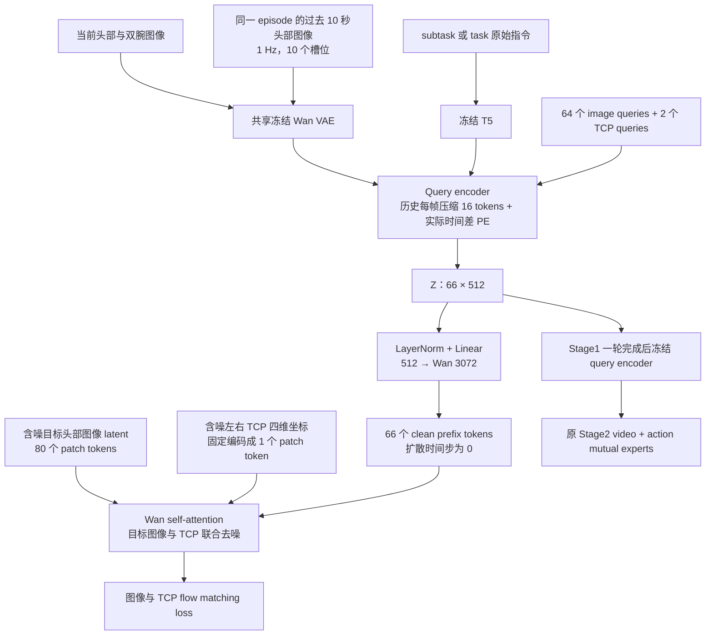

# C 方案：Wan prefix 联合去噪训练

选择 C 使用 `model.query_conditioning: prefix_self_attention`。已复用并接入两次 500 步过拟合验证的实现；原 A/B 配置仍可显式选择，未改变旧配置的默认模式。

## 模型结构



Prefix 只能读取 prefix；含噪图像/TCP 可以读取 prefix 和彼此。Stage1 不再经过 Wan 原文本 MLP、cross-attention，也不保留 80 个零 observation prefix。T5 仍负责编码输入指令；没有直接 TCP readout 辅助头。

Stage2 仅从 bundle 加载 `encoder.*`，保持固定 66 个 latent；C 的条件 adapter 和图像/TCP 去噪器不参与 Stage2 推理。图像 VAE、文本编码及 query encoder 仍需要执行。

## 配置

| 入口 | 配置路径（仓库内） | 训练预算 |
|---|---|---|
| Stage1 smoke 数据 | `configs/goal/stage1_query_prefix_sample.yaml` | 5000 步，500 步评估 |
| Stage1 3000h 数据 | `configs/goal/stage1_query_prefix_3000h.yaml` | 100000 步，500 步评估 |
| smoke 数据两阶段 | `configs/goal/stage12_query_prefix_sample.yaml` | 单卡，Stage1 3 FPS 一轮 → Stage2 5000 步 |
| 3000h + posttrain 两阶段 | `configs/goal/stage12_query_prefix_posttrain_3fps_4x8gpu.yaml` | 4 节点 × 8 卡，Stage1 3 FPS 一轮 → Stage2 100000 步 |

有限遍历也提供 `stage1_query_prefix_epoch.yaml`（默认 15 FPS）、`stage1_query_prefix_epoch_3fps.yaml`、`stage1_query_prefix_epoch_sample.yaml`。当前选用 3 FPS 只改变当前帧抽样，历史仍为过去 10 秒 1 Hz。有限遍历按已有 task/subtask 规则覆盖索引，`max_steps` 不决定其一轮长度。

所有 C 配置使用：

```yaml
model:
  goal_representation: query_latent
  query_conditioning: prefix_self_attention
learning_rate: 1.0e-5
condition_learning_rate: 1.0e-4
history_learning_rate: 1.0e-4
history_enabled: true
```

`condition_learning_rate` 只作用于 `condition_projection`，历史压缩器使用独立 history 参数组；不会重复分组或解冻被禁用的 text MLP/cross-attention。省略该字段时保持原来跟随主干学习率的行为。正式训练保留已有颜色扰动、patch mask、view dropout；单样本对照曾关闭当前图像增强，因此完整训练不是直接复刻其全部超参。

历史训练逐帧 mask 概率为 0.2；TimePE 编码真实帧时间差。每次 episode 切换清空特征缓存，首帧及不足历史的位置 mask。关闭历史需在所用 Stage1 与 Stage2 配置中同时设置 `history_enabled: false`，流水线会检查两者匹配。

## 启动

在包含本次提交的仓库根目录执行。以下命令将结果放在 CPFS；`sample` 指真实 smoke 数据，`--smoke` 才是合成小模型检查。

```bash
# 单独训练 Stage1（真实 smoke 数据）
/root/miniconda3/envs/openwam/bin/python scripts/train_goal_curated.py \
  --train --config configs/goal/stage1_query_prefix_sample.yaml \
  --output-dir /mnt/data/cpfs/b5/yeqingda/openwam-0911/OpenWAM/outputs/stage1_c_sample_run01

# 3000h：将上面的配置替换为 stage1_query_prefix_3000h.yaml，使用新的输出目录。

# 自动两阶段：先离线准备并检查，再启动训练（单卡 smoke 数据版）
/root/miniconda3/envs/openwam/bin/python scripts/train_stage12.py \
  --config configs/goal/stage12_query_prefix_sample.yaml --prepare
/root/miniconda3/envs/openwam/bin/python scripts/train_stage12.py \
  --config configs/goal/stage12_query_prefix_sample.yaml --check
/root/miniconda3/envs/openwam/bin/python scripts/train_stage12.py \
  --config configs/goal/stage12_query_prefix_sample.yaml --train
```

4×8 版本：离线准备/检查时将配置替换为 `stage12_query_prefix_posttrain_3fps_4x8gpu.yaml`。DLC 的现有入口使用 `STAGE12_CONFIG` 指向此配置，并按原流程验证 prepared marker；四节点由现有分布式启动器协调。不要在单卡 DSW 上直接执行该配置的 `--train`。本次没有提交或重启 DLC。

两阶段的 `--prepare` 只准备有限索引与统计；必须在 GPU 作业提交前完成。此处不声称已经重新准备完整 3000h 索引。Stage1 覆盖证明和 checkpoint 校验通过后才交接 Stage2。

## 数据与路径切换

配置默认使用以下现有来源，均为 CPFS 绝对路径：

- smoke：`/mnt/data/cpfs/b5/yeqingda/pretrain/launch/moravla/train_files/pretrain_v0_3_curated_smoke.yaml`
- 单独 3000h：`/mnt/data/cpfs/b5/yeqingda/pretrain/launch/moravla/train_files/pretrain_v0_3_curated_3000h.yaml`
- 两阶段 posttrain：`/mnt/data/cpfs/b5/yeqingda/openwam-0911/OpenWAM/outputs/offline_stage12_3fps_20261025/source.yaml`，来自已排除 wipe_table 的 posttrain 选择。

可通过 `OPENWAM_SOURCE_YAML` 覆盖数据 YAML；单独 Stage1 也支持 `--source-yaml`。两阶段应统一设置该环境变量，不能只改变其中一个阶段。`OPENWAM_STAGE12_OUTPUT` 指定新的流水线输出目录，`OPENWAM_GOAL_CACHE` 指定 Stage1 缓存；均应设置为 CPFS 路径。改变数据后重新离线准备和检查，不混用旧选择的统计/覆盖证明。

`OPENWAM_BASELINE_CHECKPOINT` 指定 Stage1 预训练权重文件；`STAGE2_BASELINE_CHECKPOINT` 指定 Stage2 原训练目录/权重。C 适配器与 A/B 拓扑不同，切换到 C 使用新的 run 与优化器，不直接续接 A/B 的 optimizer state。此前 ABC 单样本 C checkpoint 仅用于诊断，不作为正式全量训练默认初始化。

## 验证范围

- 两个真实 subtask 样本均已完成 C 的 500 步联合图像/TCP 训练；ABC 样本有完整 10 帧历史。
- 回归覆盖 C 联合梯度、prefix 可见性、图像/TCP 相互作用、保存/重新加载、Stage2 encoder-only 提取及有限遍历后冻结。
- 本次新增正式学习率分组及配置/入口检查。单样本重构不能证明语言泛化或 Stage2 控制效果；本次没有运行完整 Stage2 大模型训练。
