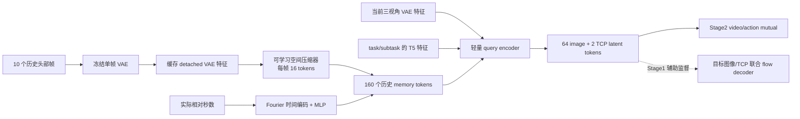

# 带历史输入的 Query Latent：操作与实现说明

本版本在 `codex/query-latent-goal` 的独立 checkout 中增加可选历史分支，当前没有启动正式训练。入口仍支持原来的无历史 query 方案和 patch 联合去噪方案。

## 指令确实是 task/subtask 原文

`CuratedGoalDataset` 选择当前语言区间，把 `segment['text']` 写入 `record['instruction']`；`prepare_batch` 用 `TextContextCache.get(record['instruction'])` 获取冻结 T5 特征。`GoalQueryTransformer.text_projection` 将这些特征作为 query 的注意力 memory。Stage2 的 `prompt` 同样来自选中的区间文字。

有可用 subtask 的 episode 按现有采样设置同时提供 task/subtask；没有可用 subtask 的只提供 task。不是 VLM 文本辅助任务，也不会自动生成或分解 subtask。目标时刻和 TCP 监督保持原来的定义：task 的原始指令区间末帧，subtask 的连续区间末帧；TCP 始终在目标头部图像坐标下。

## 结构



历史分支只使用头部图像，固定为 H256×W320，沿用现有 clean head resize。冻结 VAE 为每帧产生 48×1×16×20 特征；2×2 patchify 后得到 80 个 192 维空间 token。16 个可学习 query 通过一次 128 维 cross-attention 压缩该帧，再投影到 query encoder 的 512 维空间。此处没有“池化结果加可学习残差”的旁路，也没有额外的历史 VLM。

每帧独立压缩，不读取其他历史帧、当前图像、指令或未来目标；只有目标 queries 将历史、当前图像和语言融合。历史 token 不被写回 memory，因此不存在历史读取未来帧的路径。大 decoder/Stage2 接收的 Z 仍是 66 个 token。

参考 [OpenDM 源码](https://github.com/dexmal/opendm/tree/fe1ed79a22d81cc1bfbeb2b4418bbb79fc75fc50)：主视角历史采样见 `opendm/data/transforms.py`，视觉池化/注入见 `opendm/model/dm05/dm05_arch.py`。这里采用可学习压缩并增加真实时间间隔编码；不照搬其 VLM token ID、prefix KV 或位置网格接口。

## 采样、时间与缓存

- 10 个历史槽位不包含当前帧，按远到近排列。训练从当前帧向过去累积采样 `[0.5,1.5]` 秒间隔，均值为 1 秒；评估固定 1 秒。
- 实际选中帧舍入到源视频 ordinal；时间编码使用 `(anchor_index-history_index)/fps`。这是现有解码器验证的 CFR 视频时间，不伪称硬件采集时间戳。跳帧后的实际间隔可由相邻 age 相减得到。
- 不跨 episode，也不越过选中的连续 curated 区间；允许同一选中区间内跨 subtask 边界。短区间不足 10 秒时补 mask，不重复首帧。例如本次 5 秒样例只有 4 个有效历史槽，这不是 10 个都有效的演示。
- 源数据全局无效标记（`canonical.frame_valid` / `training.valid`）也用于屏蔽历史帧。无效/缺失槽位不能参与注意力，NaN padding 被屏蔽；有效时刻必须为正并严格从大到小排序。当前与未来帧不能伪装成历史。
- 历史不做随机图像增强，保持可缓存；当前 Stage2 图像仍沿用原增强设置。
- 缓存保存冻结 VAE 的特征，绝不保存训练中的压缩器输出。按预处理后图像内容、VAE 对象/参数版本、设备和精度区分缓存；单个 encoder 默认最多 256 项，使用 CPU LRU。训练随机换 episode 时可能经常未命中，不能声称训练开销等同热缓存推理。
- 训练和普通推理传 `history_images`；需要避免传历史 RGB 的调用方可以传已经由同一 VAE 编码的 `history_latents`。这两种输入二选一，始终同时提供 `history_ages` 和 `history_valid`。外部 latent 的编码器、预处理与 checkpoint 必须相同。
- 每个 episode/会话的历史缓冲由调用方维护，reset 时调用 `goal_expert.clear_history_cache()` 并清空调用方帧列表。没有新增机器人在线采集服务。时间编码不进特征缓存；同一图像随时间变老仍产生不同条件。

## 训练边界与配置

历史压缩器保留 FP32 参数和计算，使用小的非零随机初始化及独立 `history_learning_rate: 1e-4`；其他 Stage1 参数沿用 BF16 + FP32-master AdamW、基础 LR `1e-5`。Stage1 图像/TCP 辅助损失训练压缩器，冻结 VAE 不接收历史梯度。Stage2 冻结整个 query encoder，包括历史压缩器；当前版本没有让 action loss 反传训练它。

```yaml
model:
  goal_representation: query_latent
  query_history:
    enabled: true
    num_frames: 10
    tokens_per_frame: 16
    compressor_dim: 128
    cache_size: 256
history_learning_rate: 1.0e-4  # Stage1
dataset:  # Stage2 对应 dataloader.history
  history:
    enabled: true
    num_frames: 10
    mean_interval_s: 1.0
    jitter_fraction: 0.5
```

Stage2 preset 额外设 `goal.history: ${model.query_history}`。上述槽位/采样规则当前固定，配置验证拒绝不支持的值。历史分支默认关闭；不传新字段时旧 checkpoint 按原路径加载。启用历史需要训练带历史模块的新 bundle，旧的无历史权重不能直接当作已训练历史模型。当前 CLI 仍从原 action/video baseline 初始化 Stage1 辅助 decoder、随机初始化 query/历史模块；未增加旧 Stage1 optimizer 的断点恢复。

| 用途 | smoke selection | 3000h selection |
|---|---|---|
| Stage1 | `configs/goal/stage1_query_history_sample.yaml` | `configs/goal/stage1_query_history_3000h.yaml` |
| Stage2 | `configs/goal/stage2_query_history_sample.yaml` | `configs/goal/stage2_query_history_3000h.yaml` |

无历史继续选择 `stage1_query_*` / `stage2_query_*`；旧 patch 方案继续选择 `stage1_multiview_*` / `stage2_multiview_*`。

## 全量一轮与自动阶段切换

新增入口见 [stage12_one_pass.md](stage12_one_pass.md)：支持 15 FPS 有限总体、8 卡、完整优化器恢复和自动冻结 Stage2。以下旧 `train_goal_curated.py` 命令仍是原单进程随机采样接口。

## 操作命令

```bash
cd /mnt/data/cpfs/b5/yeqingda/openwam-0911/OpenWAM/outputs/query_latent_20261020/code
export PYTHON=/root/miniconda3/envs/openwam/bin/python
export SAMPLE_YAML=/mnt/data/cpfs/b5/yeqingda/pretrain/launch/moravla/train_files/pretrain_v0_3_curated_smoke.yaml
export LARGE_YAML=/mnt/data/cpfs/b5/yeqingda/pretrain/launch/moravla/train_files/pretrain_v0_3_curated_3000h.yaml

# CPU 合成验证：小 Wan blocks + TinyVAE，2 步，不加载大模型。
"$PYTHON" scripts/train_goal_curated.py --smoke \
  --config configs/goal/stage1_query_history_sample.yaml --device cpu --steps 2 \
  --query-dim 32 --query-num-heads 4 --query-num-layers 2 --query-ffn-dim 64 \
  --output-dir outputs/history_synthetic_check

# 真实数据输入预检：无模型，含历史帧、秒数、有效 mask 和精确 NPZ。
"$PYTHON" scripts/train_goal_curated.py --preflight \
  --config configs/goal/stage1_query_history_sample.yaml \
  --source-yaml "$SAMPLE_YAML" --output-dir outputs/history_sample_preflight
```

实际训练需先设置原 baseline 的 `OPENWAM_BASELINE_CHECKPOINT`，以及匹配 tokenizer 的路径。以下命令供后续执行，本次未启动：

```bash
"$PYTHON" scripts/train_goal_curated.py --train \
  --config configs/goal/stage1_query_history_sample.yaml \
  --source-yaml "$SAMPLE_YAML" --device cuda \
  --output-dir outputs/history_stage1_sample_run1
```

3000h 将 preset 换成 `stage1_query_history_3000h.yaml`、source 换成 `$LARGE_YAML`。Stage1 仍是单进程流式入口。每 500 步评估并保留独立 `eval_step_*`，在 `timeline.html` 追加图像/TCP预测和误差。

Stage2 先设置与所选数据匹配的 `STAGE2_STATS_REGISTRY`、原 `STAGE2_BASELINE_CHECKPOINT`、新历史版 `STAGE1_GOAL_CHECKPOINT`、`STAGE2_OUTPUT_DIR`、`STAGE2_SOURCE_YAML`。这些变量含义与原操作手册一致。使用新 Hydra preset，先预检再启动：

```bash
"$PYTHON" scripts/train.py --config-name goal/stage2_query_history_sample \
  goal.preflight=true

"$PYTHON" -m torch.distributed.run --standalone --nproc_per_node=1 \
  scripts/train.py --config-name goal/stage2_query_history_sample goal.preflight=false
```

切到 3000h 时换为 `goal/stage2_query_history_3000h`，同时切换 selection 和 normalization registry。原 `launch_stage2.sh` 默认仍选择无历史 preset，勿仅改变 checkpoint 而保留原 preset。

验证记录与实际输入展示位于仓库根 `outputs/head_history_20261023/`。其中合成 smoke 仅验证计算、梯度和保存接口；真实数据报告仅验证输入一致性；测速没有运行大 decoder 或 Stage2，均不能代替过拟合/泛化效果验证。
