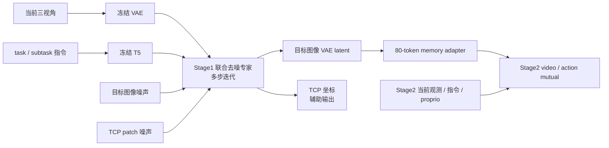
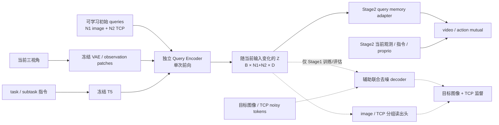

# Stage1 / Stage2 操作手册：联合去噪与 Query Latent 两种方案

本文对应 `codex/query-latent-goal`，基于 `2490537` 的三视角 Stage1、Stage2 实现。
新方案采用**独立、单次前向的目标 latent 提取器**；Stage2 冻结它，直接读取 tokens。
旧方案仍为默认值。下列完整训练命令供启动实验使用，不代表已经执行。

## 1. 模型结构与切换

核心模型超参为 `model.goal_representation`：

| 模式 | `patch_denoise`（旧） | `query_latent`（新） |
|---|---|---|
| Stage1 输入 | 当前三视角 + 当前 task/subtask 指令 | 相同 |
| 目标表征 | 迭代去噪得到的头部 goal VAE latent | learnable queries 经过一次 Transformer 得到 Z |
| Stage1 主辅助任务 | 头部目标图像 / 4D TCP 联合 flow matching | 以 Z 为唯一外部条件的同类联合 flow matching |
| Stage1 分组监督 | 无 | image 组重建目标 VAE latent；TCP 组回归左右 UV |
| Stage2 memory | 80 个图像 patch，不含 TCP patch | N1 image + N2 TCP tokens |
| Stage2 目标分支计算 | 默认 20 次 goal 去噪网络前向 | 1 次 query encoder 前向 |
| Stage2 加载权重 | 独立冻结的 Stage1 去噪专家 | 仅独立冻结的 query encoder |
| Stage1 bundle | `patch_goal.safetensors` | `query_goal.safetensors` |
| 三视角 bundle format | `openwam.goal.patch.v2` | `openwam.goal.query.v1` |
| Stage2 conditioner | `image_memory` | `query_memory` |

旧方案：



新方案：



随机初始化只发生在创建模型时，queries 随训练更新，不是每次推理重新采样。
真正传给 Stage2 的是处理后的 **Z**，不是固定 query 参数。
Query Encoder 的 API 只接收当前观测、指令和有效位；没有未来图像、TCP GT、
终点帧、diffusion timestep 或 noise 输入。

辅助 decoder 仍采用联合 flow matching。它只读取由 Z 投影得到的 context，
没有原始语言或当前图像旁路；为了复用 Wan decoder，保留一个固定零 latent
prefix，它不包含观测，也不会额外调用 VAE。
分组读出头仅用于辅助回归监督，Stage1 可视化中的图像和 TCP 来自联合去噪结果。
Stage2 不加载 decoder、condition projection 或分组读出头，也不执行这些预测。

## 2. 配置文件与默认超参

| 阶段 / 数据 | 原三视角方案 | 新方案 |
|---|---|---|
| Stage1 smoke 数据 | `configs/goal/stage1_multiview_sample.yaml` | `configs/goal/stage1_query_sample.yaml` |
| Stage1 3000h 数据 | `configs/goal/stage1_multiview_3000h.yaml` | `configs/goal/stage1_query_3000h.yaml` |
| Stage2 smoke 数据 | `configs/goal/stage2_multiview_sample.yaml` | `configs/goal/stage2_query_sample.yaml` |
| Stage2 3000h 数据 | `configs/goal/stage2_multiview_3000h.yaml` | `configs/goal/stage2_query_3000h.yaml` |

旧 head-only 模式仍使用 `stage1_joint_*` / `stage2_joint_*`，bundle 为 patch.v1。
它不等于已训练的三视角模型。旧 Stage1 bundle 不能直接加载为 query 模型。

新模型默认配置：

```yaml
model:
  goal_representation: query_latent
  query_goal:
    num_image_tokens: 64
    num_tcp_tokens: 2
    dim: 512
    num_heads: 8
    num_layers: 4
    ffn_dim: 2048
```

`num_tcp_tokens` 是 TCP 表征容量，可以改变；最终监督仍是左右各一个二维点，
顺序 `[uL,vL,uR,vR]`，不会随 N2 改变。`dim` 必须能被 `num_heads` 整除。
默认值只是起始配置，尚未通过大规模消融证明最优。

| 训练超参 | Stage1 | Stage2 |
|---|---|---|
| smoke / 3000h 默认步数 | 5000 / 100000 | 5000 / 100000 optimizer updates |
| batch | 单进程，batch1 | 每卡 batch1，gradient accumulation 默认1 |
| 精度 | BF16 | BF16 |
| 优化器 | FP32-master AdamW | 既有 Accelerate / DeepSpeed Stage2 |
| 学习率 | `learning_rate: 1e-5` | video `1e-5`、action `1e-4`、projection `1e-3`、goal adapter `1e-4` |
| 联合 flow loss | `lambda_image: 0.5`、`lambda_tcp: 1.0` | 原 video/action/FK loss |
| query 分组回归 loss | `lambda_query_image: 0.1`、`lambda_query_tcp: 0.1` | 不执行，encoder 冻结 |
| 评估 | step0、每500步、最终步 | 同左，按成功 optimizer updates |
| 辅助生成步数 | `sampling_steps: 20`，仅影响评估生成 | query 的 `goal.num_steps: 1`；原 action/video 仍 `evaluation.num_steps: 20` |

新模式 Stage1 总损失：

```text
0.5 × image flow loss + 1.0 × TCP flow loss
+ 0.1 × image-group latent MSE + 0.1 × TCP-group UV MSE
```

图像和点监督分别使用实际有效 mask；无效点 / NaN 不参加 TCP loss。
两个分组读出头约束 token 的用途，但不声称表示已经完全解耦。
可在自定义 Stage1 YAML 中调整这两个权重进行消融。

## 3. 工作目录、依赖和数据

本次实现的隔离 checkout：

```bash
export OPENWAM_CODE=/mnt/data/cpfs/b5/yeqingda/openwam-0911/OpenWAM/outputs/query_latent_20261020/code
cd "$OPENWAM_CODE"
export PYTHON=/root/miniconda3/envs/openwam/bin/python
export DATA_CONFIG_ROOT=/mnt/data/cpfs/b5/yeqingda/pretrain/launch/moravla/train_files
export SAMPLE_YAML="$DATA_CONFIG_ROOT/pretrain_v0_3_curated_smoke.yaml"
export LARGE_YAML="$DATA_CONFIG_ROOT/pretrain_v0_3_curated_3000h.yaml"
```

两份数据均通过同一流式 reader：
有可用 subtask 时 task/subtask 默认各50%；只有 task 时只训练 task。
task goal 取 episode 末帧，subtask goal 取对应指令区间末帧。
末帧不自动等同成功完成帧。

配置文件名中的 `v0_3` 不决定数据根目录。实际根目录来自 selection YAML，
不要因为名称而强制替换。Stage1 可用 `--data-root`，Stage2 可用
`dataloader.data_root=...` 显式覆盖；切换根目录后重新匹配 normalization registry。

Stage1 需要原 baseline safetensors、冻结 VAE/T5 和 tokenizer。
`OPENWAM_BASELINE_CHECKPOINT` 指向 Stage1 bootstrap baseline；
tokenizer 不在默认位置时传 `--tokenizer-path /实际/tokenizer目录`。
这些路径属于部署环境，必须指向已有资产，不能用新 Stage1 bundle 替代原 baseline。

```bash
export OPENWAM_BASELINE_CHECKPOINT=/实际路径/baseline/checkpoint.safetensors
```

同一配置下的 Stage1/Stage2 必须使用同一冻结 VAE/T5/tokenizer 身份。
Stage2 另外需要包含 video/action/proprio 权重与重建配置的原 action/video baseline，
以及与选中数据匹配的原生 normalization registry。

## 4. 先跑合成计算 smoke

这里的 `--smoke` **不读取真实 smoke YAML 中的视频**，也不加载完整 baseline。
它使用真实的小型 Wan blocks、TinyVAE 和合成标签，验证前后向、生成、保存。

```bash
"$PYTHON" scripts/train_goal_curated.py \
  --smoke --config configs/goal/stage1_query_sample.yaml \
  --goal-representation query_latent \
  --query-num-image-tokens 8 --query-num-tcp-tokens 2 \
  --query-dim 32 --query-num-heads 4 --query-num-layers 2 --query-ffn-dim 64 \
  --steps 2 --device cpu --output-dir /tmp/query_goal_smoke_new
```

GPU 检查可改为 `--device cuda --dtype bfloat16`。输出目录必须为空或不存在。
该合成 bundle 只能用于合成验证，不能给正式 Stage2 使用：
其 text fingerprint、TinyVAE、维度与正式资产不同。

## 5. Stage1 真实数据预检与训练

先检查实际当前图像、目标图像、TCP mask 和来源：

```bash
"$PYTHON" scripts/train_goal_curated.py \
  --preflight --config configs/goal/stage1_query_sample.yaml \
  --source-yaml "$SAMPLE_YAML" --output-dir outputs/query_sample_preflight
```

这一步无模型，也不证明源相机标定正确。前一轮发现的选例/几何质量问题没有被
此次模型改动“自动修复”；原投影转换和 mask 保持原样。

启动新方案的真实 smoke 数据训练：

```bash
"$PYTHON" scripts/train_goal_curated.py \
  --train --config configs/goal/stage1_query_sample.yaml \
  --goal-representation query_latent \
  --source-yaml "$SAMPLE_YAML" --device cuda --steps 5000 \
  --output-dir outputs/query_stage1_sample_run1
```

改 N1/N2 等可以直接追加参数，例如：

```bash
--query-num-image-tokens 80 --query-num-tcp-tokens 4 --query-dim 512
```

正式图像/TCP 辅助 decoder 从 baseline 初始化，query encoder 和其读出头新建；
旧的 `--init-goal-checkpoint` 仅适用于旧 patch 模式的 head→multiview 初始化，
query 模式会明确拒绝它。新拓扑不是旧5000步模型的无损替换。

切换 3000h：

```bash
"$PYTHON" scripts/train_goal_curated.py \
  --train --config configs/goal/stage1_query_3000h.yaml \
  --source-yaml "$LARGE_YAML" --device cuda \
  --output-dir outputs/query_stage1_3000h_run1
```

启动原方案时，将配置换为 `stage1_multiview_sample.yaml` 或
`stage1_multiview_3000h.yaml`，并选择 `--goal-representation patch_denoise`。
Stage1 入口是单进程流式训练；3000h 支持指数据读取和采样支持，
不代表此次增加了分布式 Stage1 训练。

产物：

- `query_goal.safetensors`：最新评估步对应的完整 Stage1 encoder + 辅助 decoder。
- `query_goal.json`：模型维度、冻结依赖身份与训练配置。
- `summary.json` / `progress.jsonl`：训练进度、实际 loss、有效点数和数据来源。
- `inputs/`：实际送入模型的图像、GT、mask 和 NPZ。
- `eval_step_000000/`、`eval_step_000500/`……以及 `timeline.html`：
  每次预测图像、TCP 和误差保留，不覆盖历史。

Stage1 仍不支持 optimizer/RNG 完整 resume。不要将重新初始化称为断点续训。
此改动未新增外部消息提醒；每次报告完成会输出 `report_ready` 事件。

## 6. Stage2：选择模式、预检、启动

以下示例使用**已经在真实数据上训练得到的 query bundle**：

```bash
export GOAL_REPRESENTATION=query_latent
export STAGE2_GOAL_INPUT=multiview
export STAGE1_GOAL_CHECKPOINT="$OPENWAM_CODE/outputs/query_stage1_sample_run1/query_goal.safetensors"
export STAGE2_BASELINE_CHECKPOINT=/实际路径/action_video_baseline
export STAGE2_SOURCE_YAML="$SAMPLE_YAML"
export STAGE2_STATS_REGISTRY=/实际路径/sample/statistics/registry-SHA.json
export STAGE2_OUTPUT_DIR="$OPENWAM_CODE/outputs/query_stage2_sample_run1"
export NPROC_PER_NODE=1

bash scripts/launch_stage2.sh sample --preflight
bash scripts/launch_stage2.sh sample --train
```

启动器根据 `GOAL_REPRESENTATION` 选择配置，最终写入
`model.goal_representation`，不是只改变日志名称。
旧模式设置 `GOAL_REPRESENTATION=patch_denoise`，并把
`STAGE1_GOAL_CHECKPOINT` 换为对应 patch bundle。三视角继续设置
`STAGE2_GOAL_INPUT=multiview`；旧 head-only 则使用 `head`。

如果 Stage1 改过 query 数量/宽度等，Stage2 必须一致，例如：

```bash
bash scripts/launch_stage2.sh sample --preflight \
  model.query_goal.num_image_tokens=80 model.query_goal.num_tcp_tokens=4
bash scripts/launch_stage2.sh sample --train \
  model.query_goal.num_image_tokens=80 model.query_goal.num_tcp_tokens=4
```

默认 query preset 已将 `goal.query` 绑定到 `model.query_goal`。
直接用 Hydra 时选择 `--config-name goal/stage2_query_sample`；
不能只在旧 preset 上把模式名字改掉而保留旧 format/conditioner，
不匹配会在启动检查时报错。

切换 3000h 时必须同时切换 selection 和 registry，输出另起目录：

```bash
export STAGE2_SOURCE_YAML="$LARGE_YAML"
export STAGE2_STATS_REGISTRY=/实际路径/3000h/statistics/registry-SHA.json
export STAGE2_OUTPUT_DIR="$OPENWAM_CODE/outputs/query_stage2_3000h_run1"
bash scripts/launch_stage2.sh 3000h --preflight
bash scripts/launch_stage2.sh 3000h --train
```

Stage1 bundle 可以来自匹配依赖的其他数据规模实验，但必须在记录中明确；
默认实验建议 smoke 对 smoke、3000h 对3000h。
不要把 smoke 的归一化统计用于3000h。需要重新准备统计时：

```bash
# 这里继承当前 STAGE2_SOURCE_YAML；对 smoke / 3000h 分别执行、分别保存。
env -u STAGE2_STATS_REGISTRY "$PYTHON" scripts/data/preflight_stage2.py \
  --config configs/goal/stage2_query_sample.yaml \
  --prepare-stats --skip-video-export \
  --output-dir outputs/query_sample_stats
```

3000h 改用 `stage2_query_3000h.yaml` 和新的输出目录，同样清除旧 registry 环境变量。
命令默认是有界统计，不是全量视频审计；从生成的 `summary.json` 中读取实际
registry 路径，再设置 `STAGE2_STATS_REGISTRY`。

Stage2 保留原来的 action/state112、32步动作、stride4的视频预测、
gripper clip、数据增强和有效 FK loss。Query encoder 冻结，不进入 optimizer；
Stage2 学习 query memory adapter 与原 action/video 模型。
缺头部时整行 goal memory 无效；缺腕部时只屏蔽对应观测，沿用现有策略。

## 7. Checkpoint、恢复、推理与评估

Stage2 保存仍是原自包含 run：统一 action/video/adapter 权重、
完整训练状态、数据统计/选择身份与 `goal/expert.safetensors`。
下文 `RUN` 指包含 `config.yaml` 的实际 run 目录，通常位于
`$STAGE2_OUTPUT_DIR/checkpoints/<自动生成的run名称>/`，以启动日志为准，
不是 `$STAGE2_OUTPUT_DIR` 本身。
该独立资产文件保留完整 Stage1 bundle 便于追溯；
**实际加载时仅读取 `encoder.*` tensors，不构造辅助 Wan decoder。**

完整恢复从同模式、同 query 维度的 run 开始；保留原训练的有效 overrides：

```bash
"$PYTHON" -m torch.distributed.run --standalone --nproc_per_node=1 scripts/train.py \
  --config-name goal/stage2_query_sample \
  training.finetune_ckpt_path=null \
  training.resume_ckpt_path=/实际路径/query_stage2_RUN
```

如果原训练改过 token 数量、层数或步数，恢复命令也必须保留相同配置。
切换旧/新模式或改变 N1/N2/D 是新实验，应从原 action/video baseline warm-start，
不能从另一种 Stage2 checkpoint 强行恢复。

部署仍走既有 Stage2 公共 `generate` / checkpoint loader。Query 模式直接计算 Z，
不会生成 goal 图像或实际 TCP 坐标；action/video 的去噪次数没有被改为1。
共享冻结 VAE 权重，不保证共享编码结果：干净 goal 观测与增强后的
Stage2 观测不同，可能仍有独立编码调用。

Stage1 的每500步报告仍显示辅助图像/TCP 预测及误差。
Stage2 query 报告显示 action/video 预测、曲线和误差，保存 query tokens；
因为没有加载辅助 decoder，goal image / TCP 预测误差明确为 unavailable，
不画伪预测、不把 latent 当图像解码。目标 GT 与来源仍保留供检查。

```bash
"$PYTHON" scripts/eval_stage2.py --run-dir /实际路径/query_stage2_RUN --steps 500 1000 --device cuda
"$PYTHON" scripts/eval_stage2.py --run-dir /实际路径/query_stage2_RUN --history-only
```

## 8. 验证边界

本次验收包括小模型真实前后向、两组 query 梯度、缺视角/文本 mask、
checkpoint 保存重载、仅 encoder 加载、Stage2 token memory、公共生成与报告，
以及旧模式回归。最终实际命令和结果写在同目录的
[验证记录](query_latent_verification.md)中。

这些检查证明接口和计算链可执行，不证明动作成功率、3000h 收敛或吞吐收益。
需要后续按相同数据、相同 Stage2 预算比较两种模式，并加入移除/打乱 Z 的消融。
