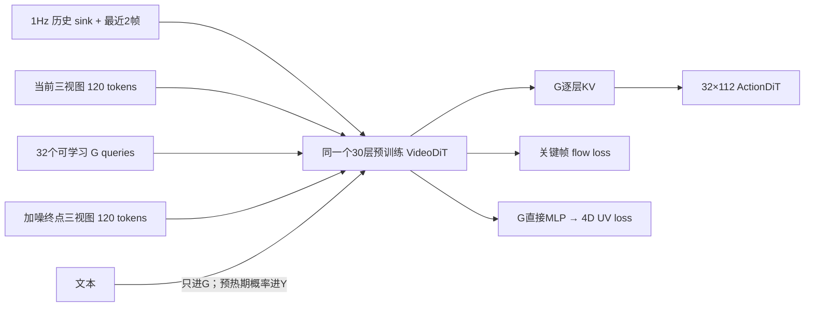

# RFC goal-memory 分支实现与最小对照

基线 `3c34210`；分支 `codex/rfc-goal-memory-1hz-20261111`。依据飞书 RFC revision71，按 2026-11-11 用户确认覆盖：KF1 单目标，不做 KF2 +3s；不做 gist/长窗口；历史每秒一个三视图 T=1 latent；task:subtask 默认 3:7；各自监督同粒度指令终点。终点标签是弱监督完成状态，不等于经过成功筛选的轨迹。

## 结构



图中共享模块内部由 mask 划分：历史每帧只看本帧；当前帧只看当前帧；G 读历史、当前和 G；关键帧只读当前、G 和自身。历史帧不进行帧间 attention；它们严格来自当前时刻之前，因此满足数据因果性，并允许跨 chunk 缓存。

1Hz 版本采用每秒独立 T=1 VAE 编码，和 RFC 的 stride4 视频因果 VAE 压缩不同。保留显式帧时间和窗口相对 RoPE。推理只算一次干净 video/G，默认 isolated 下随后只对动作去噪；对照 action_sees_video 必须使用带视频的推理路径。

## 最小验收单元

| 点 | 固定条件与干预 | 必须满足 |
|---|---|---|
| 指令／历史瓶颈 I1 | 固定 G 每层 KV，替换文本或历史；关闭预热 | 关键帧预测不变；文本不能绕过 G；CA 的输出 bias 也被屏蔽 |
| 目标独立 I2 | 固定当前、历史和文本，改变目标噪声／diffusion t | G 不变；干净组始终 t=0 |
| 动作隔离 I3/I4 | isolated 下删除未来视频／关键帧，改变动作噪声 | 动作结果保持；视频侧不读动作；推理没有遗留 video16次前向 |
| 数据因果 I5 | anchor 在边界、短 episode、缺失 camera、非整数 FPS | 每个历史 frame_id < anchor；不重复，标签图像与 TCP 是同一终点 |
| 可缓存 I6 | 单帧／完整窗口／滑窗复用，切换 episode | G 与动作在数值容差内一致；不同 episode 不串 KV |
| mask 稳健性 | 空历史、padding、缺失视图／点中填入 NaN | 有效输出和 loss 有限；无效部分无监督贡献 |
| 续训／采样 | 中断恢复，与连续训练比较 | 权重、FP32 master/moments、RNG、全局 cursor 和 3:7 调度保持一致 |

## 最小实验对照

不要跑所有选项的笛卡尔积。每个对照只改一个因素；固定数据索引、训练预算、随机种子、图像和 TCP mask、评测 episode、归一化及动作定义。task 和 subtask 分开报数，也报 3:7 加权值，避免粒度构成掩盖退化。

| 对照 | 最小设置 | 回答的问题／指标 |
|---|---|---|
| 架构替换 | 当前 C* vs 新共享 G | 同预算关键帧 FM、TCP 像素误差、动作误差／成功率、步耗时与显存 |
| 历史贡献 | 新 G 默认 vs 无历史；另在评测打乱同长度历史 | 是否使用过去信息；不能只靠当前图与文本完成 |
| G 贡献 | 默认 vs 去掉 G；另在评测交换 G | 瓶颈是否承载目标；交换测试首先测语义敏感性，不当作成功率 |
| RFC 对照 d | isolated+G vs action_sees_video+G | 是否值得付出联合视频推理成本；动作成功率及端到端 chunk 延迟 |
| RFC 对照 a/f | 冻结 Video/G；解冻+KFaux=0.1；解冻+KFaux=0 | 动作收益、关键帧语义漂移及计算开销 |
| 缓存 | 同一权重／输入 cache off/on，冷／热各测 | 数值一致性、VAE解码次数、prefill/动作去噪耗时；不是训练效果对照 |
| 粒度 | 同一 checkpoint 的 task/subtask 分组；有预算再比纯task／纯subtask | 3:7 混训是否让某一粒度明显退化 |

模型单测通过只证明路由与数值合同，不能证明新结构优于旧 C*。训练及 held-out 机器人成功率需要独立实验。

## 当前实测边界

2026-11-11 本机 H20-3e，真实 foundation VideoDiT 权重、30 层×3072、32 G、120 target token、3 个历史单位，合成 latent／文本；不含 T5、DataLoader、优化器 step 和 DDP：

| 检查 | 结果 |
|---|---|
| BF16 前向＋反向 | 约 0.326s，峰值 19.0 GiB，G 与首层 Q 梯度有效 |
| FP32 缓存／重算 G | 相对 L2 1.86e-6；热缓存 176ms、重算 295ms（一次配对） |
| BF16 缓存／重算 G | 相对 L2 1.27%；热缓存约42–51ms、重算66–67ms（三次配对） |
| 真实 WanVideoVAE38，两张独立 T=1 三视图 | batch2 65.3ms、逐帧108.2ms；磁盘缓存往返逐位一致 |

BF16 的跨 chunk KV 误差来自原生 RoPE 把旋转后的 Q/K 转回 BF16：同一帧在独立编码时位于 phase0，在窗口中具有不同 phase，舍入打破了精确平移不变性。FP32 已通过文档量级的一致性检验；低精度跨 chunk KV 复用默认关闭，实验性开启需显式允许近似。离线冻结 VAE latent 缓存照常使用。时间数字不能当作整步训练吞吐或动作效果，正式比较需固定数据并计入优化器及加载开销。

证据位于 `/mnt/data/cpfs/b5/yeqingda/CodeX/docs/2026-11-11/openwam-goal-memory-implementation/`。`native-gpu.json`、`native-gpu-fp32.json`、`real-vae.json` 保留完整计时范围与误差。尚未启动正式训练或新 DLC。

## 入口与配方

使用 `scripts/train_goal_memory.py`，与旧 `train_goal_curated.py` 分开。单进程入口支持严格 resume；不会修改运行中的 DLC，也未声称完成多卡 DLC 吞吐验收。

```bash
# 不加载权重：实际 source-native 图像／标签／历史 mask 检查
python scripts/train_goal_memory.py --preflight --config configs/goal/stage1_goal_memory.yaml --output-dir /new/preflight
# 与训练相同的 VAE 类／权重／dtype；只加载 VAE，离线批量填充历史缓存
python scripts/data/precompute_goal_memory.py --config configs/goal/stage1_goal_memory.yaml --device cuda --dtype bfloat16 --batch-size 4 --report /new/cache-coverage.json
# 同一命令加 --audit-only：只审计覆盖率，不解码／编码缺失历史
# 新 Stage1（正式启动需显式 --train）
python scripts/train_goal_memory.py --train --config configs/goal/stage1_goal_memory.yaml --output-dir /new/stage1 --device cuda --dtype bfloat16
# Stage2 需显式 Stage1 新格式 bundle 与原生动作归一化 registry
STAGE1_GOAL_MEMORY_CHECKPOINT=/new/stage1/goal_memory.safetensors STAGE2_STATS_REGISTRY=/path/registry.json python scripts/train_goal_memory.py --train --config configs/goal/stage2_goal_memory.yaml --output-dir /new/stage2 --device cuda --dtype bfloat16
```

`--smoke --steps 2` 使用原生小宽度 Wan block 和合成 latent，不加载生产权重。`--steps` 是完整训练／预热预算；只限制本次执行用 `--stop-after N`。恢复时保持配置与预算不变，传 `--resume /run/resume.pt`；恢复模型、FP32 master、Adam moments、RNG 与全局采样 cursor。新格式拒绝旧 C* checkpoint，不能把旧架构优化器当作新 G 的连续训练。

消融配方：`stage1_goal_memory_no_history.yaml`、`stage1_goal_memory_no_g.yaml`（屏蔽 G keys，保留 UV 辅助分支以控制参数量）、`stage2_goal_memory_action_video.yaml`、`stage2_goal_memory_frozen.yaml`、`stage2_goal_memory_no_aux.yaml`。交换文本／历史／G 与 cache off/on 属于同 checkpoint 干预，不必各自重训。

独立加载策略（输入为冻结 VAE/T5 的 latent/context 和已归一化本体状态）：

```bash
python scripts/infer_goal_memory.py --checkpoint /run/stage2/policy.safetensors --dependencies /run/stage2/dependencies.json --inputs /path/latent_inputs.pt --output /new/normalized_actions.pt --device cuda --dtype bfloat16 --steps 10
```

输出为归一化 32×112 动作；真实机器人部署仍需匹配原生 registry 做反归一化。Stage2 对比均从同一个 Stage1 bundle 初始化；foundation 的 80→112 动作／本体投影通过已有受检零填充迁移，原有 80 维权重保留。默认参数组：VideoDiT 1e-5、动作／G 新参数 1e-4、本体投影 1e-3。

Stage2 先把 Stage1 候选区间与原生动作有效窗口相交，再保持 3:7 和仓库权重采样；不会取样后另抽一个不对应的动作锚点。registry 指纹纳入恢复与策略依赖合同；样本级检查生成戳，避免逐步重读整个统计文件。

最终定向验收：210 项通过（新 core／数据／Stage2／缓存／恢复／推理入口，以及受影响的旧 C* 和原生 reader 测试）。这不是整仓测试通过声明；旧 `test_goal_epoch_data.py` 两个 target_path fixture 失败和 `test_dlc_offline_ready.py` 的 `/tmp` 与 CPFS gate 不匹配已单独记录。

真实 30 层／3072 VideoDiT＋1024 ActionDiT GPU 验证还覆盖了 Stage2：FP32 prefill／完整前向动作相对误差 2.10e-7；BF16 为 0。none／joint 前向＋反向均有限，BF16 峰值约23.0 GiB，FP32约45.8 GiB。输入为合成 latent／文本，新增 G 未正式训练，无 optimizer step。结果仅证明路径可运行；不证明效果优于当前 C*。

恢复补充验证：精确续训还绑定实际模型每个 tensor 的 dtype／device、CPU／CUDA autocast 设置与 RNG 设备映射，在修改模型、optimizer 或 RNG 前拒绝不匹配（含 FP32→BF16）；缺少执行合同的早期 resume 文件也拒绝精确恢复。预算已完成的 resume 仍会重新发布当前 Stage1／Stage2 权重与 update 元数据，可恢复新输出目录或同目录缺失／陈旧 bundle，且不推进采样 cursor 或 RNG。`dataset.max_cached_episodes` 直接控制 reader 缓存上限，未配置时保留 8。此修复定向覆盖 46 项 CPU 测试通过，未新增 GPU／多进程验证。
实际执行合同同时写入 `summary.json` 和 bundle 的 `training.execution`，以实际 tensor 的 dtype／device 与 autocast 为准；原始 recipe 保留原值，不能用 recipe 的 dtype 字段推断 CLI 覆盖后的精度。

恢复额外绑定实际 tensor dtype／设备、autocast 精度与 RNG 设备映射；校验发生在任何状态写入之前。实际执行信息单独记录在 summary 与 bundle 的 training.execution 中，优先于原始 recipe 的 dtype 字段。已完成预算时也会重新导出恢复后的 goal／policy，支持新输出目录以及缺失／过期导出资产的恢复。
