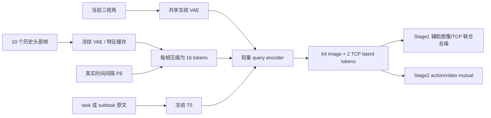

# Stage1 完整遍历一轮 → 冻结 → Stage2

本文默认描述原 15 FPS / 8 卡配置；新增 [3 FPS / 单机 32 卡版本](stage12_3fps_32gpu.md) 使用独立 preset 和输出目录。

本入口针对当前 **query latent + 10 帧头部历史** 方案。先训练 Stage1 图像/TCP 辅助任务，覆盖全部选定的有效当前帧与指令配对；最后一个更新完成并保存完整检查点后，自动启动原 Stage2 action/video mutual 训练。代码位于 `outputs/query_latent_20261020/code` 的 `codex/query-latent-goal` checkout。

## 一轮的定义：方案 2

- 源视频按 15 FPS 网格取当前帧，本批数据的源 FPS 全为 30，因此取偶数 ordinal；不复制帧来补采样率。
- task 有效区间提供 task 样本；同时具有 subtask 标注的帧再提供一份 subtask 样本。task/subtask 原文都作为语言条件。这里不使用 `subtask_probability` 的随机替代采样。
- 当前帧必须严格早于对应指令的原始终止帧。task 使用 task 区间最后一帧，subtask 使用连续 subtask 区间最后一帧，均不把随机训练 chunk 的最后一帧改成目标。
- `training.valid` / `canonical.frame_valid` 无效当前帧被排除并计数；历史有效性、TCP 有效性继续沿用各自 mask。末帧只是弱目标，不自动成为成功标注。
- 所有符合条件的 `(源目录, episode, 指令区间, task/subtask, 当前帧)` 恰好覆盖一次。两类指令共享当前帧是两个不同的训练样本。
- SQLite 用紧凑区间保存总体，按目录、episode、语言层级和帧序遍历。**没有全局随机打乱**；这样保持源读取局部性。它保证覆盖，不保证这一采样顺序的训练效果最优。
- 一轮更新数是 `ceil(total_samples / world_size)`。8 卡每卡 1 个样本，无梯度累积；尾批缺口用零权重占位，真实样本梯度按有效数量重新加权，不丢最后几个样本。

不能从“3000 小时”直接得到精确样本数：还要计算指令重叠、无效帧和末帧排除。以最终 `population.json` 为准；不按旧 `max_steps: 5000/100000` 截断 Stage1。

## 数据选择

原始 YAML：

```text
/mnt/data/cpfs/b5/yeqingda/pretrain/launch/moravla/train_files/pretrain_v0_3_curated_3000h_posttrain_20261019.yaml
```

根据用户授权，仅排除缺失目录 `/mnt/data/cpfs/b5/post_train_data/wipe_table/wipe_table_v1_test` 的 **55 个片段、118653 个源帧**。原始 YAML 未修改，保留项的 episode/frame ranges 未修改。

本次派生文件：

```text
outputs/stage12_posttrain_selection/source.yaml
outputs/stage12_posttrain_selection/exclusions.json
```

剩余 **5904 个源目录、326298 个片段、373325815 个源帧**。Stage1 和 Stage2 共用这份派生 YAML。它的 SHA256 为 `d9724d334eacbda0d3425a0dd2d6bbf4a3bcc43216cbecae811af15489e481b8`；附带脚本从原始 YAML 重新生成已验证得到同一个 SHA。

绝对路径的 native 29/34/64 维数据使用已核验的原始关节/夹爪命令字段。缺少标定或里程计时屏蔽对应几何监督；不会把可视化用的路径替换、相对局部动作或零填充头部 EEF 当真值。归一化统计基于有限的 profile 样本，**不是所有帧精确统计**；其 immutable registry 必须和当前选择、物理约定匹配。

## 模型与阶段边界



Stage1 使用原 action/video baseline 的 DiT/VAE/T5 初始化；query 和历史压缩器按现有实现初始化，不默认拿小样本过拟合结果充当全量起点。Stage1 基础 LR `1e-5`，历史模块 LR `1e-4`，BF16 主模型配 FP32 master AdamW，历史模块保留 FP32。历史 10 帧只进 query encoder，大模型仍接收固定 66 个 latent tokens。

Stage2 从最终 bundle **只加载冻结 encoder**，包括历史压缩器；移除 Stage1 辅助生成 decoder。Stage2 自身 action/video 模型从原 baseline 初始化，保留 action112、32 步 chunk、每 4 帧视频、夹爪 clip、增强及现有有效 FK loss。Stage2 默认 `max_steps: 100000`，单独配置；这不是第二个完整数据 epoch 的承诺。

## 启动

```bash
cd /mnt/data/cpfs/b5/yeqingda/openwam-0911/OpenWAM/outputs/query_latent_20261020/code
export PYTHON=/root/miniconda3/envs/openwam/bin/python

# 当前机器已有派生文件；迁移 checkout 后可从原始 YAML 精确重建。
"$PYTHON" scripts/data/prepare_stage12_selection.py \
  --original-yaml /mnt/data/cpfs/b5/yeqingda/pretrain/launch/moravla/train_files/pretrain_v0_3_curated_3000h_posttrain_20261019.yaml \
  --output-yaml outputs/stage12_posttrain_selection/source.yaml

# CPU 准备：建立全部 finite index，审计 Stage2 源元数据，生成匹配统计注册表。
# 可能耗时较长；索引逐 episode 提交，中断后重复该命令继续构建。
"$PYTHON" scripts/train_stage12.py --prepare

# 检查 prepared index、源身份、统计契约、baseline 路径；不加载大模型。
"$PYTHON" scripts/train_stage12.py --check

# 明确开始 8 卡训练；Stage1 完成后自动切换 Stage2。
"$PYTHON" scripts/train_stage12.py --train
```

默认配置是 `configs/goal/stage12_query_history_posttrain.yaml`，Stage1 使用 `configs/goal/stage1_query_history_epoch.yaml`，Stage2 使用 `goal/stage2_query_history_3000h`。两阶段会在独立子进程运行；Stage1 退出并释放资源后才加载 Stage2。

当前配置默认指向已有 `gripper_human_aug_lr0.0001_b320` 的 step1000 baseline。可设置 `OPENWAM_BASELINE_CHECKPOINT` 替换 Stage1 初始化权重，设置 `STAGE2_BASELINE_CHECKPOINT` 替换 Stage2 初始化目录。VAE/T5/tokenizer 必须匹配，Stage2 完整 preflight 会再次验证。`STAGE2_STATS_REGISTRY` 可提供匹配当前 selection 的现成注册表，否则使用 `--prepare` 的结果。

若选择 smoke 数据，复制 pipeline YAML，修改 `source_yaml` 为 smoke YAML、`output_dir` 为新目录、`stage2_config` 为 `goal/stage2_query_history_sample`，并按需要调小 `stage2_max_steps`。然后同样执行 `--config /绝对路径/新配置.yaml --prepare / --check / --train`。换数据必须重建 finite index 和统计契约。

## 评估、检查点和恢复

- 每 **500 次全局 optimizer update** 评估固定训练示例，图像/TCP 预测保留在独立 `eval_step_*`，在 `stage1/timeline.html` 追加，含每数据集/粒度图像 MAE、TCP 像素误差。最终更新也评估。这是训练诊断，不是泛化成功率。
- 默认每 **5000 次更新** 保存全状态，并在最终更新保存。检查点间隔与评估间隔分开，避免每 500 步写出大体积优化器。
- 完整检查点含 model、FP32 masters、Adam moments、全局 cursor、配置/源/代码身份及文件 SHA256；不能拿旧的 model-only bundle 做精确优化器恢复。
- 只保留最近两个已提交 checkpoint；评价图片保留。文件先写临时目录，校验并提交后才更新 `latest.json`。
- `epoch_complete.json` 只有 `seen_samples == total_samples` 且最终检查点已提交才写入。进程退出成功本身不能触发 Stage2。Stage2 启动前重新校验其 hash 和完整覆盖。
- Stage1/Stage2 配置和统计/模型资产身份都参与恢复检查；不能用 `--resume` 偷换训练预算或数据。变更实验应使用新输出目录。

```bash
# Stage1 中断：恢复最后完整提交点；其后未提交的更新会重放。
"$PYTHON" scripts/train_stage12.py --train --resume

# Stage2 已开始后中断：必须显式给 Stage2 full-state checkpoint，Stage1 不重训。
"$PYTHON" scripts/train_stage12.py --train --resume \
  --stage2-resume /绝对路径/Stage2完整恢复目录
```

恢复保持相同 world size；当前不支持弹性改变卡数。`progress.jsonl` 保留中断前记录，以 `latest.json` 中 cursor 为提交边界，不能把日志最大 step 当作已保存进度。数据索引按依赖文件 size/mtime 和投影后的标签/有效性 SHA 检查；源数据应保持不可变。

## 已验证与边界

- 小模型 CPU 完整训练、FP32 master/Adam 恢复、双进程 Gloo 末批同步、失败/部分覆盖禁止切换。
- 真实 12 个 canonical family + native 29/34/64/counterfactual，共 16 个 episode 的有限索引：19331 个 task/subtask 配对，97 个紧凑区间；首末 32 次实际图像/历史采样通过。
- native 154 个 metadata headers、四个代表来源的物理量和统计读取已验证。
- `train_stage12.py --prepare` 已在上述 16 个 episode 的独立 probe 配置上实际跑通 finite index + Stage2 元数据审计 + 统计生成；该 probe 不是正式全量注册表。
- **没有启动全量生产训练，也没有完成全量有限索引/注册表准备；未实测 8 卡大模型速度或峰值显存。**8 卡 DDP 每卡仍持有完整模型和优化器，不等于显存除以 8。既有单卡小样本缓存测速不能当全量解码吞吐；正式启动前应在实际卡型上单独测完整更新峰值。
